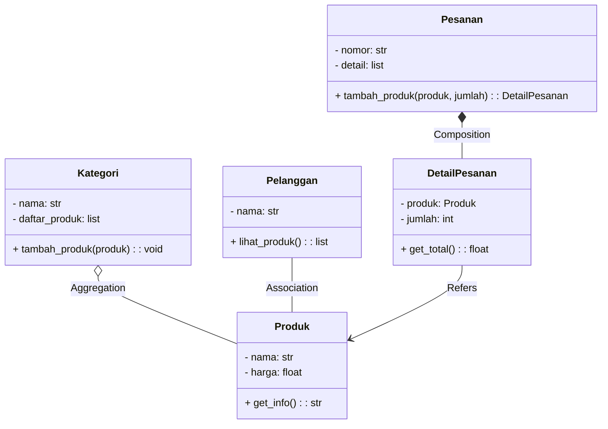

# Aplikasi Manajemen Produk & Transaksi Penjualan — MVC + Streamlit + SQLite/MySQL

Aplikasi berbasis Python dengan pola **Model-View-Controller (MVC)** yang disesuaikan secara presisi dengan **Rancangan Class Diagram Studi Kasus**, serta dilengkapi **Sistem Autentikasi Pengguna (Login & Register)**.

---

## 1. Implementasi Sesuai Class Diagram

Aplikasi mengimplementasikan 5 entitas utama beserta atribut, method, dan relasinya:



### Rincian Entitas:
1. **`Produk`** (`models/produk.py`)
   - Atribut: `- nama`, `- harga` (disertai `stok` dan `kategori_id`).
   - Method: `+ get_info()`: Mengembalikan ringkasan string produk, kategori, harga, dan stok.
   - Relasi: *Aggregation* dengan `Kategori`, *Association* dengan `Pelanggan`.
2. **`Kategori`** (`models/kategori.py`)
   - Atribut: `- nama`, `- daftar_produk` (koleksi produk dalam kategori).
   - Method: `+ tambah_produk(produk)`: Menambahkan objek produk ke dalam kategori.
3. **`Pelanggan`** (`models/pelanggan.py`)
   - Atribut: `- nama`.
   - Method: `+ lihat_produk()`: Mengambil daftar produk yang tersedia untuk pelanggan.
4. **`Pesanan`** (`models/pesanan.py`)
   - Atribut: `- nomor`, `- detail` (koleksi `DetailPesanan`).
   - Method: `+ tambah_produk(produk, jumlah)`: Membuat dan menambahkan item pesanan.
   - Relasi: *Composition* dengan `DetailPesanan` (lifecycle item terikat penuh dengan pesanan).
5. **`DetailPesanan`** (`models/detail_pesanan.py`)
   - Atribut: `- produk`, `- jumlah`.
   - Method: `+ get_total()`: Menghitung subtotal (`produk.harga * jumlah`).

---

## 2. Struktur Proyek MVC

```text
manajemen_produk_mvc_database/
├── app.py                         # Halaman utama: Autentikasi & Dashboard navigasi
├── pages/
│   ├── 1_Produk.py                # Halaman CRUD Produk (Tabel, Tambah, Edit, Hapus dialog)
│   ├── 2_Kategori.py              # Halaman Manajemen Kategori (Aggregation Produk)
│   ├── 3_Pelanggan.py             # Halaman Manajemen Pelanggan (Association Produk)
│   └── 4_Pesanan.py               # Halaman Manajemen Pesanan & Transaksi (Composition)
├── models/
│   ├── __init__.py
│   ├── produk.py                  # Class Produk (+ get_info())
│   ├── kategori.py                # Class Kategori (+ tambah_produk())
│   ├── pelanggan.py               # Class Pelanggan (+ lihat_produk())
│   ├── pesanan.py                 # Class Pesanan (+ tambah_produk())
│   ├── detail_pesanan.py          # Class DetailPesanan (+ get_total())
│   └── user.py                    # Class User (Sistem login & otentikasi)
├── views/
│   ├── auth_view.py               # Tampilan UI Login & Register
│   ├── produk_view.py             # Tampilan UI CRUD Produk
│   ├── kategori_view.py           # Tampilan UI Kategori
│   ├── pelanggan_view.py          # Tampilan UI Pelanggan & simulasi lihat_produk()
│   └── pesanan_view.py            # Tampilan UI Pesanan & DetailPesanan
├── controllers/
│   ├── auth_controller.py         # Controller sesi & enkripsi password
│   ├── produk_controller.py       # Controller operasi produk
│   ├── kategori_controller.py     # Controller operasi kategori
│   ├── pelanggan_controller.py    # Controller operasi pelanggan
│   └── pesanan_controller.py      # Controller transaksi pemesanan
├── database/
│   ├── db.py                      # Konfigurasi SQLAlchemy (SQLite / MySQL) & Seeder
│   └── manajemen_produk.db        # Database SQLite lokal
├── requirements.txt
├── .env.example
└── README.md
```

---

## 3. Akun Bawaan (Default Login)
- **Username:** `admin`
- **Password:** `admin123`

---

## 4. Cara Menjalankan

```bash
python -m venv venv
venv\Scripts\activate
pip install -r requirements.txt
streamlit run app.py
```
Akses di browser pada `http://localhost:8501`.
